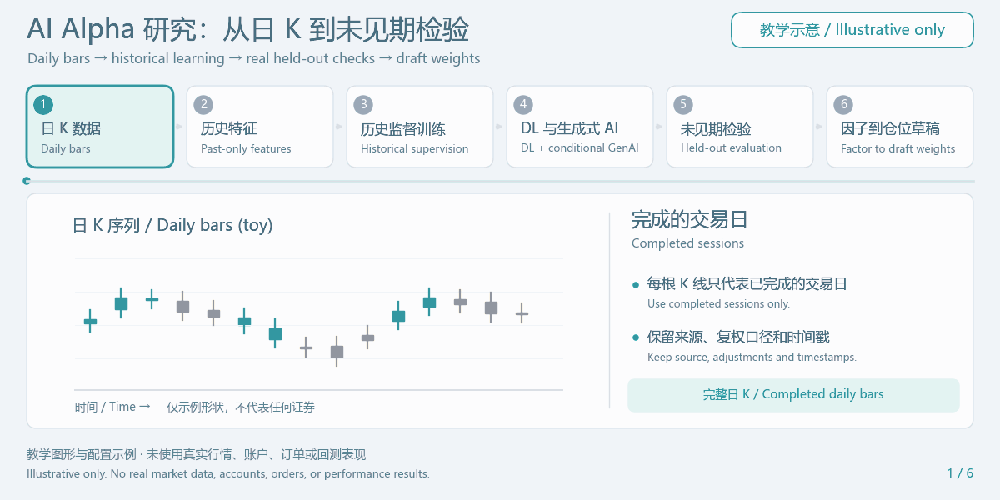

# Alpha Lab

美股日频的本机研究原型：moomoo历史行情 → 因子预测 → 风险约束与目标仓位 → 模拟订单草稿。结果界面支持中文与English，并有独立数学原理页。

第一版比较Ridge、两隐藏层MLP、重采样MLP及条件DDPM增强MLP。另有ADNN平滑IC目标的核心机制实验。这里的MLP与条件收益生成是研究设计，不是ADNN或DARL论文完整复现。

## 每日采集与自动交易系统规格

下一阶段见[实施SPEC](specs/DAILY_SIGNAL_SYSTEM.md)：最终面向真实资金的全自动交易，第一阶段先实现每日只读采集、因子／信号记录、版本与异常审计；后续分别接持续影子账本、券商模拟与实盘。文件包含模块契约、时间语义、恢复规则及25项验收场景；当前交付是规格，运行阶段尚未实现或启动。

## 论文与接口手册

- [论文资料与阅读路线](docs/papers/README.md)：朋友分享的三篇论文、原文入口、研究重点与当前复现范围。
- [moomoo API接入手册](docs/MOOMOO_API.md)：官方文档、当前日K采集方式、新机器配置和常见问题。
- [GitHub操作说明](docs/GITHUB_WORKFLOW.md)：复用现有App、仅补充目标仓库授权，以及文件核对和上传方法。
- [论文复现设计](PAPER_REPLICATION.md)与[可复现SPEC](SPEC.md)：实验对照、时点约束与验收条件。

## 训练流程动画

下面是中英双语教学示意，展示日K、历史特征、训练、GenAI增强、未见期检验和受约束决策的关系，不包含真实行情、账户、订单或回测业绩。



重新生成：先安装`requirements-media.txt`，再运行`python scripts/export_training_gif.py`。GIF可直接在GitHub README中显示；交互式原理页面单独提供。

[English GIF](docs/media/en/alpha-training-flow.gif) 使用全英文文字。运行 `python scripts/export_training_gif.py --language en` 可重新生成英文动画和暂停封面。公开网页切换语言时，会同步切换动画、封面、下载文件和 README 示例路径。

[打开公开教学页（GitHub Pages）](https://rexmiao.github.io/alpha-trading-lab/)：中英文切换、训练阶段说明、EWMA与仓位交互及数学解释。网页独立运行，不需要本机研究程序保持在线；其中的数值均为假设教学示例。[原教学页链接](https://alpha-training-lab-guide.totalbluebell3.chatgpt.site)继续保留。

GitHub Pages已启用并发布，部署配置见[操作说明](docs/GITHUB_WORKFLOW.md)及[工作流](.github/workflows/pages.yml)。后续由main的web/变更自动发布。滑块、语言切换与GIF交互均已在Pages地址验证。

网页源码与素材保存在 `web/`；本地预览可运行 `python -m http.server 8512 --bind 127.0.0.1 --directory web`，再打开 http://127.0.0.1:8512/ 。无需安装 Node 依赖或连接 moomoo。

## Python模拟与云端部署准备

新增[模拟界面](hf_space/streamlit_app.py)可按参数实际训练四组小模型，查看留出期Rank IC、含成本净值、回撤和参考权重。默认上传标准OHLCV CSV，访客也可上传；还可明确选择在线历史行情或合成教学数据；合成结果不是市场业绩，云端版本不接moomoo账户。

[Hugging Face部署说明](docs/HUGGINGFACE_DEPLOYMENT.md)、[Docker发布模板](deploy/huggingface/README.md)和[Streamlit Community Cloud部署说明](docs/STREAMLIT_CLOUD_DEPLOYMENT.md)已准备；[Hugging Face Space](https://huggingface.co/spaces/Rexymiao/alpha-trading-lab)已上线，公网实际在线取数、四模型、中英文、图表、三类下载及手机布局均已验证；[Streamlit Community Cloud](https://alpha-trading-lab-rnb8nqgww7tgbdvgdcysxm.streamlit.app/)已通过默认访客CSV、在线真实取数、四模型、快照/来源/结果下载及中英文验证。GitHub Pages主教学站独立运行，不因本地模拟或发布包存在而成为Python后台。

真实历史行情使用左侧 **Upload CSV / 上传 CSV**，基准填写CSV中的代码；本机已准备moomoo固定快照，数据与来源记录保留在`data/cloud-inputs/`，不发布到源码仓库。步骤与口径见[真实历史数据说明](docs/HISTORICAL_DATA.md)。

使用单独Python3.12环境安装云端依赖，再启动：

```powershell
python -m pip install -r hf_space/requirements.txt
python -m streamlit run hf_space/streamlit_app.py
python scripts/package_hf_space.py
```

Streamlit Community Cloud选择本仓库的`main`分支和入口`hf_space/streamlit_app.py`。Hugging Face使用生成包中的Docker结构，需先完成个人账号与创建Space所需套餐。不要把根目录只读结果查看器`app.py`当作云端模拟入口。

## 本机启动

已验证环境为Windows、Python 3.12.7、Node 20.12.2。直接依赖见requirements.txt；本机已验证的传递依赖闭包版本见requirements-lock.txt。

```powershell
python -m pip install -r requirements-lock.txt
python run.py collect
python run.py experiment
python run.py rank
python -m streamlit run app.py --server.address 127.0.0.1 --server.port 8511
```

也可以双击项目内的“启动研究界面.cmd”。页面只读取保存的结果，不自动训练或下单。第一次没有结果时会显示采集、训练命令和缺失原因。

collect需要moomoo桌面端已登录、已启用本机CLI，且有对应历史行情权限。默认复用此前PCR观察台已配置的Windows DPAPI凭据，只在内存中使用；不复制或输出密钥。其他机器可用OPENAPI_HOST_APPKEY进程环境变量及ALPHA_MOOMOO_CLI配置本机适配。没有凭据或连接时会明确失败，不改用随机价格。

## 股票池与回测口径

config.json目前包含45只主题研究股票，覆盖半导体、存储、设备、AI云、机房及服务器网络配套，并保留大型平台和跨行业对照。它尚不是已确认的用户持仓名单，SPY单独作基准。分组是当前研究主题，不是历史行业分类。逐股范围与历史处理见[研究股票池](docs/universe.md)。

SNDK从2025-02-24正式独立上市、CRWV从2025-03-28首次上市、NBIS从2024-10-21恢复交易后重新计算特征。边界之前的数据保留在原始快照中，但从研究样本排除；不会填造上市前数据，也不把所有股票缩成最短的共同历史。界面显示逐股历史覆盖和特征/标签行数。

收盘后形成信号，下一实际开盘执行。预测标签是下一开盘到第h+1个开盘的h个交易日收益减SPY同区间收益，默认h=5。所有股票共同按日期分割，训练和验证末端标签跨界的样本会删除。测试期有100个有效信号日，最后完整日K用于最新决策参考。

策略仅做多，分数超过成本门槛后按前k只选择、逆波动分配、单股封顶和组合风险缩放。使用EWMA历史协方差，包括股票间相关性。现金承接剩余权重，订单取整数股，单边成本按实际成交额扣一次。初始等权买入持有与SPY在同一个首个可执行开盘开始，作为独立参考。

回测使用复权OHLC作价格近似；股息、历史可投资名单和原始成交价等仍需进一步验证。现时点固定股票池有选择和生存者偏差。一段历史窗口、一颗随机种子和正净值不能证明预测alpha有效；结果同时展示真实留出期Rank IC。

## 论文机制实验

```powershell
python run.py rank
```

研究同日股票分组训练、平滑IC目标与普通MSE目标的差异。原始排名分数没有收益单位，须在独立验证期校准为预期超额收益后再接成本门槛和仓位规则。它复现的是ADNN的一项核心机制，未覆盖原论文GP、预训练、剪枝或完整因子池；市场、特征及可执行标签的差异在结果中列明。

## 复现和结果文件

- data/raw保存原始行情；data/manifest.json记录参数、哈希及采集错误。
- runs/latest.json是主实验结果；每次运行在独立目录保存配置、数据快照说明、归一化价格、模型权重及完整回测记录。
- runs/rank_latest.json是独立论文机制实验，和主实验分开显示。
- 模型只在训练期拟合；验证期的用途明确记录。DDPM生成器只见训练数据，不用测试表现选择参数。
- 固定代码、依赖、原始快照、配置与seed后重跑。重新采集可能带来行情修订，严格复现应使用保存的同一个快照。
- joblib权重仅供本项目自身生成后重载使用；不加载来源不明的模型文件。

完整口径与验收条件见[SPEC.md](SPEC.md)。

## 验证

```powershell
python -m pytest tests -q
```

关键检查包括时点、标签边界、未来特征隔离、生成器仅见训练集、模型重载一致、EWMA风险与相关性、现金与单股上限、下一开盘成交、费用与整数股草稿。

## GitHub与本机资料

GitHub仓库：[Rexmiao/alpha-trading-lab](https://github.com/Rexmiao/alpha-trading-lab)。仓库包含代码、复现说明、教学媒体与网页源码。data、runs、state、密钥、账户、聊天截图和本地模型权重不在上传范围内，原始moomoo数据及研究结果保存在本机。

本项目不包含券商交易提交接口。草稿采用独立模拟资本及假设持仓，必须重新报价，不能视为真实账户调仓指令。

## 原始资料

- [RL量化交易综述](https://personal.ntu.edu.sg/boan/papers/TIST23_RLFintech.pdf)
- [DARL压力情景论文](https://arxiv.org/html/2510.07099v1)
- [量化股票投资综述](https://onlinelibrary.wiley.com/doi/full/10.1111/joes.70178)
- [ADNN原始方法](https://arxiv.org/html/1912.11761)
- [EWMA定义](https://arch.readthedocs.io/en/stable/univariate/generated/arch.univariate.EWMAVariance.html)
- [Lévy过程与随机波动](https://onlinelibrary.wiley.com/doi/10.1111/1467-9965.00020)
