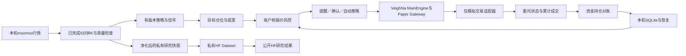

# VeighNa＋moomoo交易系统实施规格

版本0.2.0，2026-11-26。目标是完整的本机自动化交易后台；HF是公开研究展示入口。当前交付是可配置的5分钟采集／策略／持久化与券商模拟执行代码增量，真实券商模拟闭环尚未验收，不启用真钱交易。完整日频M1验收及原M1–M4阶段仍见[每日系统规格](DAILY_SIGNAL_SYSTEM.md)，不以影子回放或离线适配器测试代替券商模拟验收。

## 结构与职责



交易不依赖HF访客、HF运行进程或网页会话。源码仓库只保存代码、规格和离线测试；真实快照、账户、凭据、订单记录及数据库不上传公开仓库。

## 运行环境与入口

- `state/veighna-venv`独立安装`requirements-veighna.txt`，核心为vnpy4.5.0／futu-api10.12.7208，和HF的NumPy／pandas版本分开。旧`vnpy_futu`默认解锁／账户0代码没有被导入或连接。
- 活动目录必须由`ALPHA_RUNTIME_DIR`或CLI显式指定为本机非同步绝对路径。当前使用`C:\Users\Rexy\Documents\ChatGPT\量化准备\alpha-paper-runtime`；活动SQLite不放Dropbox。
- `execution_lab/marketdata.py`负责行情，`veighna_bridge.py`负责影子事件与受限SDK模拟适配；`rest_paper.py`／`rest_transport.py`负责独立REST模拟后端，`paper_gateway.py`承载真实VeighNa订单路由与OMS投射，`runtime.py`负责持久化、模式与调度。`scripts/run_trading_system.py`是前台入口，不自动安装开机任务。

```powershell
Set-Location -LiteralPath 'D:\Dropbox\量化反思总结\个人量化交易系统\alpha-lab'
$env:ALPHA_RUNTIME_DIR = 'C:\Users\Rexy\Documents\ChatGPT\量化准备\alpha-paper-runtime'
& '.\state\veighna-venv\Scripts\python.exe' '.\scripts\run_trading_system.py' capture-once
& '.\state\veighna-venv\Scripts\python.exe' '.\scripts\run_trading_system.py' status
# 明确启动前台循环；Ctrl+C停止，不等于撤单或清仓。
& '.\state\veighna-venv\Scripts\python.exe' '.\scripts\run_trading_system.py' watch
```

新数据库默认`ALERT_ONLY＋NONE`。已有策略模式保留在数据库中，未显式传参不重置。LIVE无代码开放路径；SHADOW历史回放和BROKER_PAPER来源／账本／账户ID命名空间分开。

## 行情与信号

1. 当前桌面链路为`moomooapp-cli.exe → 本机Host22222`，只调用行情订阅与K线；不接收任意公网Host。业务错误可能写stderr，错误分类保留ret_type／err_code而不回显密钥。
2. XNYS日历固定4.11.2，每根5分钟结束后10秒具备采集资格；处理美东DST、休市与13:00半日收市。没有已完成bar时不读凭据、不请求行情。收市后可补最后一根，但不允许因此盘后开新仓。
3. 供方5分钟时间为bar-end；规范化bar-start=end−5分钟，available_at=end，实际observed_at单独记录。以本机真实1分钟和5分钟交叉验证为依据，不静默挪动未知时间标签。
4. 股票和SPY必须覆盖当日开盘至最新应完成bar的共同网格；缺失、落后、非法OHLC、未来bar整批失败，不补价、不产生零预测或清仓信号。
5. 第一条运行策略为本日6根回看正动量，需要7根完成K线，长仓／现金。分数是历史收益，不是DL预测收益；尚未配置的DL／GenAI模型保持独立未配置状态，不随每日任务重训或偷偷替换。
6. 策略实例版本包含股票池与风险配置指纹。原始快照、bar、正式信号不可修改；同一bar重跑幂等，历史bar修订单独阻断审计，不重发委托。

本机paper试点把正目标映射为0／1股，受现金和权重上限约束，不宣称已实现按完整目标权重持续调仓。当前没有预定日终强平；停止或收市不会自动卖出。本机执行策略与HF研究的“三规则、日终退出”不同，真实paper验收前须明确隔夜持仓与退出政策，不能把网页研究曲线当成此执行器的回测。SHADOW持久执行尚未实现，CAPTURE选择SHADOW会明确未配置；当前SHADOW只提供独立`shadow-replay`。

## 三种执行策略与持久化

| 模式 | 行为 |
| --- | --- |
| ALERT_ONLY | 留存信号及目标，不创建提交意图；NONE环境不读取账户 |
| CONFIRM_BEFORE_SEND | 留存同一提案，只有明确确认后在原有效时间／policy epoch重新校验 |
| AUTO_EXECUTE | 仅对新提案通过同样风控后自动分发；旧alert、旧epoch和过期提案不补执行 |

SQLite使用WAL、FULL同步、显式事务、租约与比较状态更新。提交前必须先提交稳定client_id、订单经济内容及SUBMITTING；RPC中崩溃或timeout归SUBMISSION_UNKNOWN，不盲重试。重启先恢复与对账，未知未消除时阻止新委托。

pause只停新委托，不撤单、不清仓；resume只恢复未来信号。停止、撤销剩余订单、平掉本系统持仓是独立操作。更换模式、环境或账号不会迁移在途委托或把影子持仓变成券商持仓。

## 模拟执行门槛

- 传统SDK账户必须显式核验为ACTIVE、US、股票／期权模拟账户。REST则只从`GET /sim-trade/accounts`选择精确字符串`account_id`，核验个人训练账户`account_type=1`、`market_id=100`、`broker_id=0`；REST文档没有ACTIVE字段，不凭空补齐。两类ID不可混用，不默认首账号、不用SDK acc_id0，不解锁真实交易。[REST账户字段](https://open.moomoo.com/zh-cn/api/sim-trade/account-list)
- 原型最多每次采集分发1张1股限价单、名义额上限1000美元；不卖空，不将现有手工持仓自动纳入管理。持仓需与已持久化的本系统累计成交重建数量一致。
- 报价必须是供方实际事件时间且不超过5秒；5分钟bar收盘参考价不能冒充实时可执行报价。缺报价、延迟权限、未来报价或休市阻止提交。
- USD实际现金与总资产均须可取得；购买力不充当现金。单股上限、现金下限、卖出可用数量及费用预留在下单前检查。配置缺失时明确未配置／风控阻止，不以默认零值绕过。
- SDK显式传DAY／RTH／adjust_limit0／不允许盘前盘后。REST显式传`order_trade_time_type=1`和限价类型，但官方下单参数没有`time_in_force`，本地DAY意图不等于wire保证；首次真实模拟下单前须核对券商默认，随后再核对订单返回的`time_in_force`，不向接口杜撰字段。成功响应只确认订单身份，不能直接当成交；撤单确认也不能抹掉部分成交。[REST下单参数](https://open.moomoo.com/zh-cn/api/sim-trade/input-order)、[订单期限与状态字段](https://open.moomoo.com/zh-cn/api/sim-trade/order-list)
- 纸面后端未配置时不回退SHADOW；所有本地成交必须标SHADOW。公开HF没有执行适配器、券商凭据或订单操作。

## 真实回报与恢复

传统OpenD paper不支持Deal查询／成交推送及完整费用API，不能等待不存在的deal回调或伪造deal_id。依据已匹配本系统委托的累计`dealt_qty`及`dealt_avg_price`计算数量与金额增量，标记`derived_from_order_cumulative`。新REST使用自身`cum_qty`／`avg_fill_price`及状态枚举，由单独适配器转换，未经核实不声称有paper WebSocket。

同数量重复回报不重复记成交；部分成交先记正增量再处理撤单终态；旧回报不回滚新状态，同数量改均价进入修订对账，累计数量下降暂停。回报可早于下单响应，需按明确client_id／remark缓冲匹配。账户、backend和订单身份不明的回报不能进入账本。

重连读取选定模拟账户的未完成／近期订单、持仓与USD资金；先持久化对账再允许新单。未知提交无法可信匹配时保持阻止，由人工核实，不在“未查到”时立即重发。

REST首版自动查询范围是今日订单；跨日UNKNOWN不会凭今日列表为空而消除，历史订单恢复尚未接入。只有唯一、完全相同remark／股票／方向／数量／限价／账户的限价订单可绑定未知意图，市价单或多匹配保持人工对账。资金映射为`total_asset→total_assets`、`max(0,balance−hold)→us_cash`，原始字段缺失即不可用，不用`max_power_long`补零或替代。[资金字段](https://open.moomoo.com/zh-cn/api/sim-trade/cash-info)

## VeighNa模拟执行与OMS边界

`PaperGatewaySession`使用vnpy4.5.0的真实`MainEngine`、`OmsEngine`及`BaseGateway`，仅挂OMS引擎，无新券商连接。提交经过`runtime → session → MainEngine.send_order(OrderRequest) → gateway.send_order → 同一个adapter.submit_limit`；`OrderRequest.reference`和本地OrderData ID为稳定client_id，真实broker order ID保留在`extra`。未配置时拒绝运行，不转影子撮合。限价原始十进制文本独立保留，避免VeighNa浮点展示改变重试经济内容。

SQLite FULL事务COMMIT成功后才调用`sync_from_state`投射OrderData与TradeData；这一步不发网络、不回写适配器、不建第二份现金账本。TradeData ID确定性包含backend／账户／订单／累计数量，成交标记`derived_from_order_cumulative`、`broker_deal_id=None`。无可信官方成交时刻时，datetime采用观察时刻并明确`timestamp_basis=projection_observed_at`。重复状态不重复发布成交；订单终态、累计数量、源时间或已持久化成交回退会被拒绝。

恢复只从持久化状态重建OMS，不重发委托。OMS投射失败不回滚已提交SQL，也不冒称数据库持久化失败；运行器记`OMS_SYNC_FAILED`并跨重启阻止新意图，完整对账和投射成功后才恢复。投射锁不跨订单RPC，允许持久化后的异步回调；关闭session不会撤单、平仓或触碰手工持仓。当前适配器导出状态不含完整资金冻结／全账户持仓字段，因此**不生成AccountData或PositionData**，report明确标注unavailable；资金、持仓真相仍来自受控券商查询。

## REST显式配置与授权边界

`build_rest_paper_adapter`仅在显式选`--backend REST_sim_trade`的执行／对账命令中调用；CLI还要求BROKER_PAPER环境。默认status／pause／resume／shadow-replay不加载REST认证。工厂先要求实时quote provider，再读取显式`--paper-config`或`ALPHA_REST_PAPER_CONFIG`指向的绝对私有路径；配置及私钥均不能放Dropbox。没有配置或认证时返回NOT_CONFIGURED，不读默认CLI配置、系统keyring或未知本机令牌。

支持官方已公开的Ed25519或RSA-SHA256签名：毫秒时间戳、方法、path、原始query、原始body的SHA256摘要以五字段换行组合；签名与实际发送字节一致。固定HTTPS origin为`webapi.moomoo.com`，只允许当前US模拟账户查询及1股RTH限价／撤单白名单，无重定向、自动POST重试、Reporter或登录／刷新授权动作。Bearer只能由调用方显式注入受控provider；当前CLI配置路径采用API-key签名，不会自行寻找Bearer。[官方认证与签名契约](https://open.moomoo.com/zh-cn/api/overview/getting-started)

下列只展示配置结构，占位符不是可执行账户或密钥；不包含私钥、令牌或真实账户。`authorization_confirmed`须由管理者在核对实际授权范围后明确改为true，不能用该布尔值替代券商服务端权限证明。

```json
{
  "schema_version": 1,
  "backend": "REST_sim_trade",
  "account_id": "<账户列表中的精确字符串ID>",
  "authorization_confirmed": false,
  "max_order_notional": 1000,
  "auth": {
    "type": "api_key",
    "app_key": "<管理者自行配置的AppKey标识>",
    "algorithm": "Ed25519",
    "private_key_file": "C:\\Users\\Rexy\\AppData\\Local\\AlphaLab\\rest-paper\\private-key.pem"
  }
}
```

配置就绪后的首个动作应为显式`reconcile`只读核验，而非AUTO_EXECUTE。示意命令如下，**本轮没有执行该认证／账户查询命令**：

```powershell
& '.\state\veighna-venv\Scripts\python.exe' '.\scripts\run_trading_system.py' `
  --environment BROKER_PAPER --mode ALERT_ONLY --backend REST_sim_trade `
  --paper-config 'C:\Users\Rexy\AppData\Local\AlphaLab\rest-paper\config.json' reconcile
```

工厂只GET模拟账户列表并核验配置中的精确ID；不会默认挑首账户、转换传统SDK ID或创建委托。随后runtime绑定同一账户的持久化sink，显式对账读取资金／持仓／今日订单。quote provider由本机桌面行情读取，使用供方事件时间；构造provider不等于已通过新鲜报价权限验收。缺quote、字段、权限或服务未就绪时仍阻止提交。

**上游paper-only授权尚未证实。** 官方scope示例存在`accid:<id>`，但文档未证明该约束适用于模拟业务账户ID，也未证实AppKey可只给sim-trade路径权限。本地路径白名单只能限制本程序，不会收窄凭据本身的实盘能力。默认Futu CLI v0.6.0硬编码宽scope，未采用、未登录；管理者须先核对控制台可选权限，无法取得受限权限时保留未配置并明确未完成，不自动扩大授权。

当前REST配置、权限、新鲜报价与DAY默认均未完成真实服务核验，后端仍为NOAUTH／NOT_CONFIGURED；离线工厂和配置模板不改变这一状态。

## 当前真实证据与外部前提

2026-11-26行情已接通：SPY／NVDA在11月23–25日各234根、三天合计468行；每股3页100＋100＋34，end参数实测为exclusive。CSV SHA256为`5b126b01d9bf29d4d1bb7e63735f0994b15193b3ac1792fb0b29bb130794ff14`。同日78组OHLC与1分钟右端聚合全部匹配，高精度volume匹配；整数volume37组差异（最大2、合计5）保留供方原值，不擅改。

该真实CSV已通过三种研究规则和实际VeighNa MainEngine／OmsEngine／自定义BaseGateway影子流程；后者213条信号、71张本地订单／71条本地成交，重建现金与OMS数量一致、无未结订单。**这不是券商模拟成交，broker_status仍未配置。** 本机证据在`state/veighna-qa/`，不推入公开源码。

本机11111与22222均属于OpenAPIHost，不能仅凭TCP连接把11111当独立OpenD。官方SDK初始握手30秒未返回，未查询到模拟账户；没有猜测把桌面AppKey塞入另一协议TOKEN。传统US paper正逐步停用，官方建议新模拟API。

已核新官方Futu CLI v0.6.0默认OAuth scope包含`trade:write accid:*`且不提供scope参数，同时会对非幂等POST进行通用重试。它不作为本系统默认执行传输，也未启动其登录。REST文档存在账户绑定scope示例，但是否适用于paper账户、能否做到paper-only授权尚未核实；该限制不能靠本机只调用sim路径来冒称服务端权限已经缩小。

本轮已完成**真实框架＋假broker响应**的离线贯通：`capture → MainEngine → Gateway → 同适配器 → SQLite ACK → OMS Order`；随后累计成交查询使SQLite execution与OMS Trade各增加1，重复reconcile均保持1，close没有cancel。`tests/test_paper_gateway.py`18项及REST签名／适配器56项通过，runtime另有43项通过并含上述全链路用例。真实Ed25519／RSA签名离线验签成功；这些证据只证明代码行为，认证、模拟账户查询和真实paper下单／撤单／成交均未执行，实际订单数为0。

今天是感恩节休市，下一5分钟采集资格为11月27日09:35:10美东；11月27日13:00提前收市。真实券商paper验收需认证、账户、实时权限和实际可撮合时段齐备。完整M1和券商模拟成交闭环尚未验收，不因单元测试、影子利润或HTTP连通而标记完成。

官方依据：[paper能力／US迁移](https://openapi.moomoo.com/moomoo-api-doc/en/qa/trade.html)、[新模拟API](https://open.moomoo.com/zh-cn/api/sim-trade/account-list)、[默认CLI授权源码](https://github.com/FutunnOpen/futu-cli/blob/65ba623fd952663f0bc7bc95df20b67e94aec66e/internal/auth/oauth.go)、[NYSE日历](https://www.nyse.com/markets/hours-calendars)。

## 券商模拟验收清单

| 场景 | 必须留下的证据 |
| --- | --- |
| 认证和账号 | 确定后端、受控凭据来源、只选正确US paper账户 |
| 新鲜报价 | 实际事件时间／接收时间分开；过期拒绝 |
| REST订单期限 | 首次真实模拟下单前核对券商DAY默认；本地DAY意图不冒充已发送time_in_force |
| 下单与撤单 | 稳定client_id、持久化先于RPC，受理／撤单终态分别核对 |
| 成交 | 券商订单累计数量／价格增量，不以本地Fill代替 |
| 对账 | 本系统新增仓位、USD现金、委托与成交重建一致 |
| 重启与断线 | 不重复提交、旧回报不重复记账，UNKNOWN不自动重发 |
| 模式切换 | 旧提醒不升级成订单，pause不暗中清仓 |
| 范围限制 | 无LIVE调用、无真实账户资金／持仓读取、无对旧持仓迁移 |

上述真实券商场景须逐项标记实测状态；现有离线测试证明代码约束，不能当成券商实测。HF私有Dataset／服务端只读secret与本机发布权限由管理者或接手人稍后完成，本轮不把这些设置或真实快照连接标记为已验收；原始行情不开放访客下载，公开范围为研究结果。详见[设置说明](../docs/MOOMOO_CLOUD_SYNC.md)。
